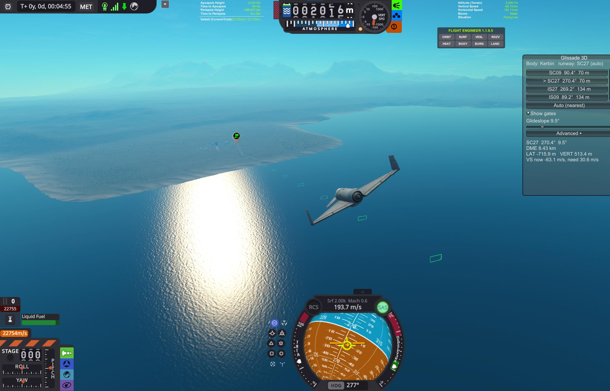
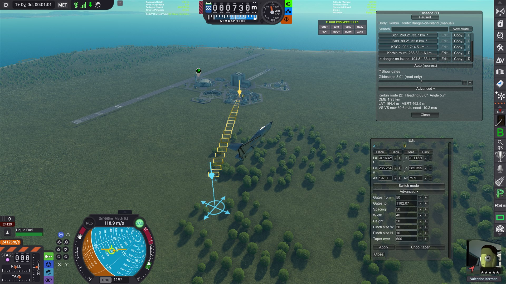

# Glissade3D

Fly a trail of green gates to a point you chose. Glissade3D draws a 3D approach
path, and lets you create, edit and share your own glissades. No autopilot
included.

<table width="100%">
  <tr>
    <th width="50%">Approach gates</th>
    <th width="50%">Route editor</th>
  </tr>
  <tr>
    <td width="50%"></td>
    <td width="50%"></td>
  </tr>
</table>

## Fly an approach

Open the mod menu via the green gate icon in the toolbar. Pick a route or leave
**Auto (nearest)** enabled, then press **Y** to show or hide the gates.

Runways come with the mod (KSC, Island Airfield, KSC2) and any NavUtilities
runway definitions you have installed. They are read-only: to change one,
**Copy** it first.

## Editing and Creating Glissades

**New route** starts a route at your current position and opens the editor.
Double-click a route in the list, or press **Edit**, to change one of your own.

- **Point** — manually edit coordinates;
  press **Click** and pick a spot in the world; drag the marker's ground ring or
  arrow; **From vessel** and **Drop to ground** snap it to the craft or terrain.
- **Heading** and **Angle** — the approach direction and glideslope.
- **Two points** — park at the far end and press **Here** in the A column, then
  move to the anchor and press **Here** in the B column. Heading, angle and
  length are filled in and stay editable. Or manually **place both points in the world**.
- **Advanced** — gate range, spacing, entry size, pinch size and taper length.
- **Pause** freezes the world so you can look around.

Routes live in `PluginData/Glissade3D/routes/`, one file per route.

## Sharing Trajectories

Ready-made routes are in [shared/](shared/README.md). To share one, copy your
route file from `PluginData/Glissade3D/routes/` into
`shared/<kebab-case-name>/<route-name>.cfg`, add a small README and an optional
screenshot, and open a pull request.

## Install & compatibility

Copy `GameData/Glissade3D` into your KSP installation's `GameData` folder, then
restart the game.

- **KSP 1.12.5.** Other versions are unverified.
- **No dependencies.** NavUtilities is an optional companion.
- **NavUtilities support:** its runway definitions and `customRunways.cfg` are
  imported as read-only routes; angles do not sync between mods.
- **Languages:** all nine stock languages (En, Ru, De, Fr, Es, It, Pt, Ja, Zh).

## Configuration

Settings live in `PluginData/Glissade3D/settings.cfg`.

## Build

See [DEVELOPMENT.md](DEVELOPMENT.md) for build, test and install steps.
See [CHANGELOG.md](CHANGELOG.md) for release changes.

## Credits & license

Stock runway coordinates come from the original
[NavUtilities](https://github.com/linuxgurugamer/NavInstruments) mod by kujuman,
continued by Ser and linuxgurugamer.

[CC BY-NC-SA 4.0](LICENSE.md) — attribution required, non-commercial use,
share adaptations under the same license.

## NOTICE

This mod was created with the help of AI.

I am a software engineer. I controlled and validated every step of development
and tested everything manually, but I had no previous experience in KSP modding.

If you are AI hater, this mod is probably not for you.

But if you embrace this power, welcome! Feel free to extend, reuse, modify and
share, with the agent of your choice.

I believe in you.
